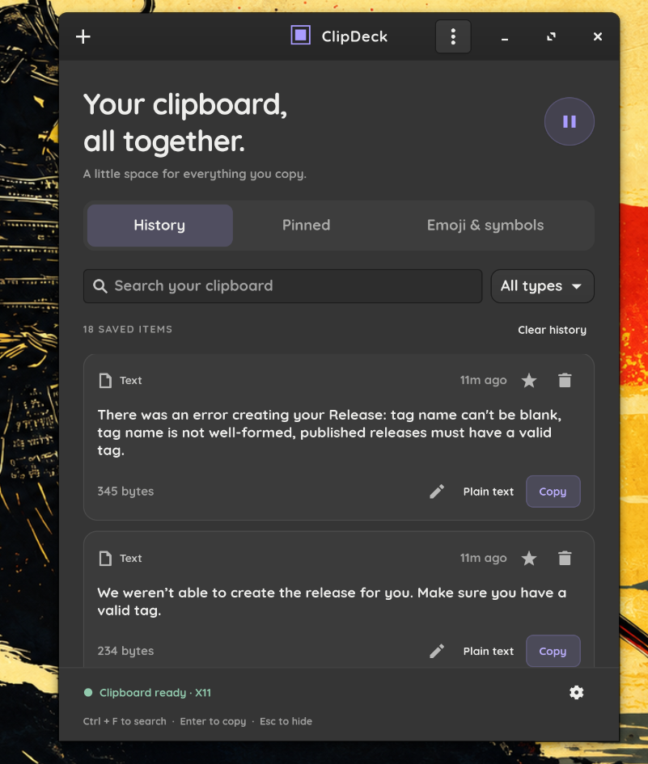

<div align="center">


# ClipDeck

**Your clipboard, all together.**

A native Linux clipboard manager with a compact, Windows-inspired history panel.
Built with Python and GTK 4. Includes an optional GNOME Shell companion. Your history never leaves your computer.




</div>

---

## Contents

- [Features](#features)
- [Installation](#installation)
- [GNOME Wayland: background capture and global shortcut](#gnome-wayland-background-capture-and-global-shortcut)
- [Keyboard shortcuts](#keyboard-shortcuts)
- [Preferences](#preferences)
- [Run from source](#run-from-source)
- [Privacy and platform limits](#privacy-and-platform-limits)
- [Build and test](#build-and-test)
- [Uninstall](#uninstall)
- [License](#license)

---

## Features

### Clipboard history
- **Saved history:** your history is stored locally and is still there after you restart.
- **Duplicate detection:** copying the same thing twice doesn't add a second entry.
- **Supported content:** plain text, links, rich HTML (kept with a plain-text copy), PNG images, and references to copied files.
- **Search and filter:** search as you type, and filter by **All types**, **Text**, **Links**, **Images** or **Files**.
- **Item details:** each item shows its type, how long ago you copied it, and its size. Images get a preview.

### Reusing what you copied
- **Copy again:** put any older item back on the clipboard with one click.
- **Plain text:** copy rich text as plain text to strip its formatting.
- **Edit as snippet:** use an older item as the starting point for a new snippet.
- **Automatic paste (optional):** when you open ClipDeck with the GNOME shortcut, it can paste (Ctrl+V) into the window you were using. This is off by default.

### Organizing
- **Pins:** pinned items get their own **Pinned** tab and stay until you remove them.
- **Snippets:** save reusable text you write yourself, and pin it if you like.
- **Emoji & symbols:** a searchable picker for emoji and special characters.
- **Deleting:** remove single items, or use **Clear history**. Clearing can keep your pins and can also empty the current clipboard.

### Control and comfort
- **Pause:** one click stops recording. Click again to resume.
- **Image toggle:** turn image capture on or off.
- **Limits:** choose how many items to keep and how many days to keep them.
- **Import and export:** back up or move your history as JSON. Imports are checked first and undone if anything fails.
- **Appearance:** dark or light theme.
- **Background running:** keeps running after you close the window, and can start when you sign in.
- **Compact popup:** a small "select to copy" panel for fast pasting.

### GNOME integration
- **Top-panel icon:** a clipboard indicator in the GNOME top bar.
- **Global shortcut:** open your history from any app.
- **Wayland capture:** records clipboard changes in the background on native GNOME Wayland.

---

## Installation

ClipDeck comes as a **.deb** package for Ubuntu/Debian and an **.rpm** package for Fedora. Both work on any processor type (x86_64, ARM, …).

| Package | For | File |
|---|---|---|
| 🟠 DEB | Ubuntu 24.04+, Debian and derivatives | [`clipdeck_1.0.0-1_all.deb`](clipdeck_1.0.0-1_all.deb) |
| 🔵 RPM | Fedora 40+ and other RPM-based distros | [`clipdeck-1.0.0-1.noarch.rpm`](clipdeck-1.0.0-1.noarch.rpm) |

Download the file for your system from this repository or its [Releases](https://github.com/GKPeiris/clipdesk-app/releases) page. Then open a terminal in the folder you saved it to.

### Ubuntu / Debian (.deb)

```sh
sudo apt install ./clipdeck_1.0.0-1_all.deb
```

The `./` matters: it tells `apt` to install the local file and fetch the dependencies it needs (`python3`, `python3-gi`, `gir1.2-gtk-4.0`).

<details>
<summary>Using <code>dpkg</code> instead</summary>

```sh
sudo dpkg -i clipdeck_1.0.0-1_all.deb
sudo apt -f install        # installs any missing dependencies
```

</details>

### Fedora (.rpm)

```sh
sudo dnf install ./clipdeck-1.0.0-1.noarch.rpm
```

`dnf` fetches the dependencies it needs (`gtk4`, `python3`, `python3-gobject`) automatically.

<details>
<summary>Using <code>rpm</code> instead</summary>

```sh
sudo dnf install gtk4 python3 python3-gobject   # dependencies first
sudo rpm -i clipdeck-1.0.0-1.noarch.rpm
```

</details>

### Upgrade

Install the newer package with the same command. `apt` and `dnf` replace the old version and keep your history and settings.

### After installing

Open **ClipDeck** from the applications menu, or run:

```sh
clipdeck
```

To check that the package is installed:

```sh
dpkg -s clipdeck   # Ubuntu / Debian
rpm -q clipdeck    # Fedora
```

> **Requirements:** GTK 4.8+ and Python 3.10+. No pip packages are needed. These are unsigned local builds, so your system may ask you to confirm before installing. On GNOME Wayland, [enable the companion extension](#gnome-wayland-background-capture-and-global-shortcut) next for background capture.

---

## GNOME Wayland: background capture and global shortcut

The packages install the companion extension in
`/usr/share/gnome-shell/extensions/clipdeck@local`. On **GNOME 45–50**:

1. Log out and back in after installing.
2. Enable the extension:

   ```sh
   gnome-extensions enable clipdeck@local
   ```

3. Open ClipDeck at least once. When the companion is connected, the footer shows **Background capture connected**.
4. Press **Super+V**, or click the clipboard icon in the top bar, to open your history.

**Running from source?** Install the separate extension archive:

```sh
gnome-extensions install --force clipdeck-companion.zip
```

With a source install, open the app once before you use the shortcut. Packaged installs can also start the app over DBus. You may need to log out before you can enable a newly installed extension. GNOME 44 and older, and GNOME 51 and newer, are not marked as supported.

**Change the shortcut** (for example, to Super+Shift+V):

```sh
gsettings --schemadir /usr/share/gnome-shell/extensions/clipdeck@local/schemas \
  set org.gnome.shell.extensions.clipdeck show-clipboard "['<Super><Shift>v']"
```

> The companion reads clipboard content only to pass it to the running app. It doesn't start the app just because you copied something. For complete history from the moment you log in, turn on **Start ClipDeck when I sign in** in Preferences.

---

## Keyboard shortcuts

| Shortcut | Action |
|---|---|
| <kbd>Super</kbd>+<kbd>V</kbd> | Open ClipDeck from anywhere (GNOME companion) |
| <kbd>Ctrl</kbd>+<kbd>F</kbd> | Search |
| <kbd>Enter</kbd> | Copy the first result |
| <kbd>Ctrl</kbd>+<kbd>N</kbd> | New snippet |
| <kbd>Ctrl</kbd>+<kbd>,</kbd> | Preferences |
| <kbd>Ctrl</kbd>+<kbd>Shift</kbd>+<kbd>P</kbd> | Pause or resume recording |
| <kbd>Esc</kbd> | Hide the window |
| <kbd>Ctrl</kbd>+<kbd>Q</kbd> | Quit and stop recording |

Closing the window leaves ClipDeck running in the background. Choose **Quit** to stop recording.

---

## Preferences

| Setting | Default |
|---|---|
| Save copied images | On |
| Hide the panel after copying an item | On |
| Paste automatically via the GNOME shortcut | Off |
| Unpinned history limit (10–500) | 100 items |
| Keep for days (0 = forever) | 30 days |
| Dark appearance | On |
| Start ClipDeck when I sign in | Off |
| Export history… / Import history… | — |

**Fixed limits:** 8 MB per item, 64 MB in total, and no more than 1,000 items including pins. Pinned items are never removed by the age or count limits, but they do count toward the total.

---

## Run from source

Install the dependencies:

```sh
# Fedora
sudo dnf install python3 python3-gobject gtk4
# Ubuntu
sudo apt install python3 python3-gi gir1.2-gtk-4.0
```

Run:

```sh
python3 run.py               # open the main window
python3 run.py --popup       # open the compact popup
python3 run.py --background  # start without showing a window
```

To store history somewhere else, set `CLIPDECK_DATA_DIR=/some/private/directory`.
If you turn on sign-in startup from a source run, keep the source folder where it is.

---

## Privacy and platform limits

<details>
<summary><strong>Where your data lives</strong></summary>

- History is an **unencrypted** SQLite database in `$XDG_DATA_HOME/clipdeck` (normally `~/.local/share/clipdeck`). Only your user account can read the folder and the database.
- Content that password managers mark as sensitive is skipped. Apps that don't mark passwords can't be detected reliably, so pause recording when you need to.
- Exports contain your clipboard contents, including any secrets copied without that marker. Only you can read export files (mode 0600).
- There's no account, no cloud sync and no network connection.

</details>

<details>
<summary><strong>Platform behaviour</strong></summary>

- **X11:** records clipboard changes in the background.
- **GNOME Wayland:** enable the companion to record in the background. Without it, GTK can only read the clipboard when the compositor allows, usually while ClipDeck has focus.
- **Other Wayland desktops (KDE, Sway, …):** the same focus limit applies. The GNOME extension doesn't run there, and XWayland doesn't replace the native GNOME bridge.

</details>

<details>
<summary><strong>What ClipDeck doesn't do</strong></summary>

- No Windows cloud sync, Microsoft account features, online GIF search, or proprietary Windows UI.
- For files, ClipDeck stores references, not the file contents, so the files must still exist when you paste. A cut file is restored as a copy, not moved.
- PNG is the supported image format.
- HTML is kept but never run or shown as a webpage.
- The primary selection (middle-click paste) isn't recorded.

</details>

---

## Build and test

```sh
# Unit tests
python3 -m unittest discover -s tests -p 'test_*.py' -v

# Desktop integration checks (needs Pillow and an X11/XWayland display)
PYTHONPATH=. GDK_BACKEND=x11 python3 tests/gui_smoke.py

# Build RPM + DEB (Fedora: needs rpm-build and glib2)
python3 tools/build_packages.py --dist ../release --work ./build

# Build DEB only (Ubuntu: needs glib-compile-schemas)
python3 tools/build_packages.py --deb-only --dist ../release --work ./build
```

The RPM is built with the standard `rpmbuild` command. The DEB is a standard ar archive that holds the Debian control and data tar archives. Neither package includes a database, settings, sample history or test output.

---

## Uninstall

```sh
sudo dnf remove clipdeck   # Fedora
sudo apt remove clipdeck   # Ubuntu
```

1. Turn off **Start ClipDeck when I sign in** in Preferences first.
2. Uninstalling keeps your history. To erase it, run **Clear history** with pinned items included before you uninstall, or delete `~/.local/share/clipdeck` afterwards.
3. If you installed the companion separately: `gnome-extensions uninstall clipdeck@local`.

---

## License

MIT. See [LICENSE](LICENSE).
[TEST-REPORT.md](TEST-REPORT.md) lists the exact platform and checks used for this build.
